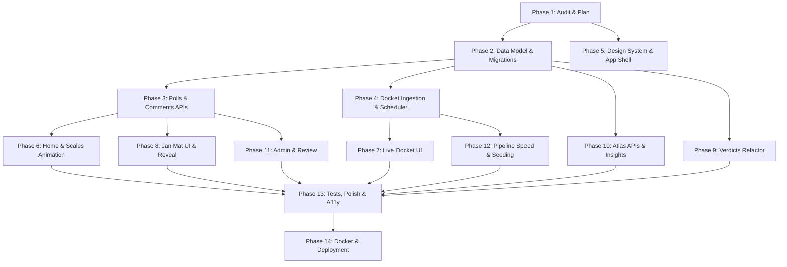

# Hetu Implementation Plan: v1 to v2 Architecture Migration

**Document Version**: 2.0.0  
**Audit Date**: October 18, 2026  
**Reference Standards**: `AGENTS.md`, `PRD.md` (v2), `ARCHITECTURE.md` (v2), `overview.md`

---

## 1. What Already Exists and Can Be Reused As Is

The existing Hetu repository contains a robust, highly functional foundational core that aligns directly with the architectural principles of v2. The following components are production-grade and can be reused as-is or with minor non-breaking extensions:

### 1.1 Backend Core & Database
- **Async Database Connection Engine** (`backend/app/db/session.py`): Fully configured async SQLAlchemy engine supporting PostgreSQL via asyncpg (`DATABASE_URL`) with async session lifecycle management.
- **Relational Domain Models** (`backend/app/db/models.py`):
  - `Document`: Normalized evidence source storage with content hashing (`SHA-256`) and unique compound keys (`case_id`, `key`).
  - `Judgment`: Structured judicial findings (facts, motive, trigger, reasoning, outcome, legal provisions, chronological timeline, evidence pointers).
  - `MediaArticle`: Journalistic coverage model capturing headlines, framing, tone, narrative claims, and referenced timeline events.
  - `PublicReaction`: Scraped comment/post entity with sentiment classification and extracted themes. Retained as a distinct, labelled historical source.
  - `GapScore`: Persisted Perception Gap metric with granular component breakdowns and weighting schemes.
- **Data Repository Layer** (`backend/app/db/repository.py`): Solid async query and upsert methods (`save_case`, `get_case`, `list_cases`, `get_document_text`, `get_evidence_quote`).

### 1.2 Ingestion & Web Collection Agents
- **TinyFish Agent Integration** (`backend/app/agents/`):
  - `tinyfish.py`: Production wrapper around the TinyFish Agent API featuring robots.txt validation, rate limiting, request timeout controls, error classification, and deterministic payload hashing.
  - `judgment.py` (`JudgmentAgent`): Reliable extraction of court judgments from Indian Kanoon without bypassing logins or paywalls.
  - `media.py` (`MediaAgent`): Multi-source news retrieval via Bing News search and article body extraction.
  - `runner.py`: Concurrent agent orchestration running collection routines safely within configured concurrency limits (`TINYFISH_CONCURRENCY`).
- **Offline Bundle Caching & CLI** (`backend/app/cli.py`):
  - Offline collection bundle loading and serialization (`fixtures/jan-mat-v-state.json`), enabling reproducible local runs without network requests or API costs.

### 1.3 LLM Extraction & Anonymization Engine
- **Multi-Provider LLM Abstraction** (`backend/app/services/llm.py`): Clean interfaces for Anthropic, OpenAI, and Groq with structured Pydantic schema validation, exponential retry logic, and strict context pacing.
- **Information Extraction Services** (`backend/app/services/extraction.py`):
  - Verbatim quote span validation (`validate_spans`): Drops hallucinated or unverified quotes that cannot be located character-for-character within source texts.
  - Paced chunking for judgment findings, media claims, and public reaction classification.
- **Anonymizer Core** (`backend/app/services/anonymizer.py`):
  - Regex replacement of Indian PII (Aadhaar, Indian mobile numbers, emails, social handles).
  - Stable pseudonym mapping for private entities (`[ACCUSED_1]`, `[VICTIM_1]`, `[WITNESS_1]`).

### 1.4 Frontend Core Shell & Verdict Components
- **Typography & Dark Editorial Design Tokens** (`frontend/src/app/globals.css`, `layout.tsx`):
  - Tailored CSS color variables (`--background`, `--foreground`, `--gold`, `--ivory`, `--navy`, `--crimson`, `--card`, `--viz-1..4`).
  - Fonts: Playfair Display (headings) and Manrope (body text).
- **Core Forensic Components** (`frontend/src/components/`):
  - `CourtVsMedia.tsx`: Side-by-side claim verification comparing media claims directly to judicial findings.
  - `EvidenceLink.tsx`: Verbatim quote modal rendering exact excerpt spans.
  - `GapIndex.tsx`: Visual breakdown of the Perception Gap Index with component weights.
  - `MediaCoverage.tsx`: Outlet framing, tone, and claim distribution.
  - `Timeline.tsx`: Chronological event sequence matching court vs media events.
- **Client API Infrastructure** (`frontend/src/lib/api.ts`):
  - Type-safe `openapi-fetch` client bound to generated TypeScript definitions (`schema.d.ts`).

---

## 2. What Must Change, Mapped to the 16 Rows of the Change Table

| # | Area | Old (v1) State | Target (v2) State | Technical Implementation Details |
|---|---|---|---|---|
| **1** | **Entry Point** | Landing page (`/`) is a search input that initiates long background scraping jobs; live log viewer. | Editorial landing page: animated hero, featured cases, poll of the week, live docket ticker. | Rewrite `frontend/src/app/page.tsx`. Remove job-start UI and log poller. Move case lookup into a top navigation search filter querying existing database records. |
| **2** | **Case Creation** | Public `POST /cases` endpoint allowing unauthenticated visitors to start ingestion. | Admin-only `POST /admin/cases` protected by `X-Admin-Key` header and rate limits. | Create `backend/app/api/admin.py`. Delete or 404 public `POST /cases`. Relocate job tracking UI to `frontend/src/app/admin/jobs/[id]/page.tsx`. |
| **3** | **Case State** | Flat cases table with no publication lifecycle or status indicators. | `status` (`ongoing` \| `decided`), `review_state` (`draft` \| `reviewed` \| `published`), `featured`, `decided_on`, `next_hearing_on`. | Alembic migration `0002_case_lifecycle_and_docket`. Update `repository.list_cases()` to filter strictly by `review_state = 'published'`. Admin routes receive draft access. |
| **4** | **Ongoing Cases** | No support for tracking ongoing cases or procedural hearings. | `hearings` table, Live Docket views (`/docket`, `/docket/[slug]`), automated refresh job. | Create `hearings` table with foreign key to `cases`. Implement `backend/app/agents/docket.py` (TinyFish search for hearing dates) and `backend/app/services/docket.py`. Add endpoints `GET /docket` and `GET /docket/{slug}`. |
| **5** | **Public Opinion** | Scraped comments only (thin sample, passive). | First-party interactive Jan Mat polls, anonymous verified votes, moderated comment threads, SSE live stream. | Create tables: `polls`, `votes`, `comments`, `comment_votes`, `reports`, `corrections`. Build `api/polls.py`, `services/voter.py`, `services/moderation.py`. Implement SSE endpoint `GET /polls/{id}/stream`. |
| **6** | **Scoring** | Perception Gap Index computes public sentiment gap solely from scraped reactions. | Blended sentiment gap weighting verified first-party votes ($w=0.6$) and scraped reactions ($w=0.4$). | Extend `backend/app/services/scoring.py` with `public_sentiment_gap(votes, reactions, w_first_party=0.6)`. Record sample size and source breakdown in component explanations. |
| **7** | **Cross-Case Insights** | No cross-case analysis; single-case views only. | Motive Atlas (`/atlas`): cross-case pattern discovery, escalation ladder, outlet bias, Sankey flow. | Create `backend/app/services/insights.py` with aggregated SQL queries over published cases (in-memory 60s cache). Build `/insights/*` endpoints and `frontend/src/app/atlas/page.tsx`. |
| **8** | **Routes** | Single case view located at `/cases/[slug]`. | Verdict analysis relocated to `/verdicts/[slug]`. Backward-compatible permanent redirect from `/cases/*`. | Rename folder `src/app/cases` to `src/app/verdicts`. Configure `redirects()` in `frontend/next.config.ts` mapping `/cases/:slug` $\to$ `/verdicts/:slug`. |
| **9** | **Jobs Architecture** | In-memory `asyncio.Task` dictionary; jobs lost on server restart. | Distributed queue using Redis + `arq` with persistent worker tasks and scheduled crons. | Replace `services/jobs.py` with `arq` task dispatcher. Create `backend/app/worker.py` with idempotent jobs (`case_ingest`, `docket_refresh`, `comment_label`). Add Redis service to `docker-compose.yml`. |
| **10** | **Database Strategy** | SQLite locally in dev/tests, PostgreSQL in Docker. | Unified PostgreSQL database across local development and Docker. | Remove SQLite fallback from `app/core/config.py` and `app/db/session.py`. Require PostgreSQL for dev via Docker Compose. Update test suite fixtures to use test database container. |
| **11** | **LLM Performance** | Defaults to Groq free plan requiring heavy token pacing and 40–50 min runs. | High-speed paid provider default (`anthropic`/`openai`) or developer tier; offline seed bundles for demo. | Set default `LLM_PROVIDER=anthropic`. Document offline fixture loading via `python -m app.cli load` so development never waits for extraction. |
| **12** | **Anonymizer Engine** | Basic exact-string substitution; misses first/last variations; no text leakage detection. | Extended alias mapping, case-insensitive boundary redaction, PII stripping, and leakage detection gate. | Update `services/anonymizer.py` with token-boundary matching and pre-save verification regex. Expose reusable `anonymize_text(text, registry)` for comment moderation. |
| **13** | **Frontend Visuals** | Static dark theme without motion or interactive visual storytelling. | Anime.js v4 animations (`ScalesHero`, `LadyJusticeReveal`, `LiveScales`), SVG drawing, native sticky scroll. | Install `animejs@4.5.0`. Build `components/motion/*` using `createScope`, `createTimeline`, `createDrawable`, and `createSpring`. Enforce `prefers-reduced-motion` compliance. |
| **14** | **Voter Authentication** | No user identity or state tracking. | Anonymous signed voter cookie (`hetu_voter`) with HMAC hash. | Implement `services/voter.py`. Set HttpOnly, SameSite=Lax cookie with UUID. Compute `voter_hash = HMAC_SHA256(secret, uuid)`. Never store raw IP addresses. |
| **15** | **Rate Limiting** | No request rate limiting. | Redis-backed distributed rate limiting via `slowapi`. | Integrate `slowapi` on FastAPI app with Redis backend. Apply strict limits on `POST /polls/{id}/vote`, `POST /polls/{id}/comments`, `POST /comments/{id}/report`, and admin routes. |
| **16** | **Test Suites** | Backend pytest only (103 tests). | Full-stack testing: Pytest + Vitest (components) + Playwright E2E + axe accessibility. | Add Vitest tests for Anime.js scoping and React components; configure Playwright E2E with automated axe-core accessibility checks. |

---

## 3. Phased Task List Matching PRD.md Section 11

### Phase 1: Audit and Plan (Current Phase)
- **Effort**: S (Small)
- **Dependencies**: None
- **Tasks**:
  1. Audit existing backend codebase and frontend structure against ARCHITECTURE.md Section 3.
  2. Deliver comprehensive `IMPLEMENTATION_PLAN.md` with no code modifications.

### Phase 2: Data Model and Migrations
- **Effort**: M (Medium)
- **Dependencies**: Phase 1
- **Tasks**:
  1. Define SQLAlchemy models for `hearings`, `polls`, `votes`, `comments`, `comment_votes`, `reports`, `corrections`.
  2. Add columns to `cases`: `status`, `review_state`, `featured`, `decided_on`, `next_hearing_on`.
  3. Create reversible Alembic migration `0002_case_lifecycle_and_docket.py`.
  4. Update `repository.py` with CRUD queries, filtering public queries by `review_state = 'published'`.

### Phase 3: Poll, Vote and Comment APIs plus Moderation
- **Effort**: L (Large)
- **Dependencies**: Phase 2
- **Tasks**:
  1. Implement `services/voter.py` for signed cookie validation and `voter_hash` generation.
  2. Implement `services/moderation.py` pipeline (PII removal, name masking, abuse checks, contempt checks).
  3. Implement `services/polls.py` for vote upserting, percentage calculation, and trending algorithms.
  4. Build FastAPI router `api/polls.py` (`POST /vote`, `GET /results`, `POST /comments`, `GET /stream` SSE).
  5. Apply `slowapi` rate limits to all voting and submission routes.

### Phase 4: Docket Ingestion (TinyFish) and Scheduler
- **Effort**: L (Large)
- **Dependencies**: Phase 2
- **Tasks**:
  1. Build `backend/app/agents/docket.py` with TinyFish news search for hearing dates and procedural milestones.
  2. Implement `services/docket.py` to reconcile hearing facts and compute next hearing timestamps.
  3. Configure `arq` worker queue in `backend/app/worker.py` and schedule daily `docket_refresh` cron.
  4. Build endpoints `GET /docket` and `GET /docket/{slug}`.

### Phase 5: Design System and App Shell
- **Effort**: M (Medium)
- **Dependencies**: Phase 1
- **Tasks**:
  1. Refactor `frontend/src/app/layout.tsx` with top navigation (Home, Docket, Verdicts, Jan Mat, Atlas, Methodology).
  2. Add breadcrumbs, active link styling, and header search filter.
  3. Implement accessible modal dialogs, drawer primitives, and toast notifications using Tailwind tokens.

### Phase 6: Home and Scales Animation
- **Effort**: M (Medium)
- **Dependencies**: Phase 3, Phase 5
- **Tasks**:
  1. Build `ScalesHero.tsx` using Anime.js v4 `createScope` and `createSpring` for dynamic balance tilt.
  2. Implement zero-vote level state ("No votes yet") and tilt capping under 10 votes.
  3. Build scroll-choreographed three-story showcase using native CSS `position: sticky` and `onScroll` sync.
  4. Integrate featured case cards, live docket ticker, and poll of the week on `/`.

### Phase 7: Live Docket UI
- **Effort**: M (Medium)
- **Dependencies**: Phase 4, Phase 5
- **Tasks**:
  1. Build `frontend/src/app/docket/page.tsx` with stage filter tabs (Notice, Charge Sheet, Evidence, Arguments, Judgment Reserved).
  2. Implement `DocketCard.tsx` displaying stage badge, court name, next hearing date, and "Last checked" time.
  3. Build `frontend/src/app/docket/[slug]/page.tsx` with vertical `HearingTimeline.tsx` and source news coverage links.

### Phase 8: Jan Mat UI and Lady Justice Reveal
- **Effort**: L (Large)
- **Dependencies**: Phase 3, Phase 5, Phase 6
- **Tasks**:
  1. Build `frontend/src/app/jan-mat/page.tsx` with sort tabs (Trending, New, Most Divided).
  2. Build `frontend/src/app/jan-mat/[pollId]/page.tsx` with interactive `VoteWidget.tsx` and `ResultsBars.tsx`.
  3. Implement `LiveScales.tsx` with draggable tokens on fine pointers (`(pointer: fine)`), tap buttons on touch screens, and idle sway when `prefers-reduced-motion` is off.
  4. Implement `LadyJusticeReveal.tsx` unmasking sequence (sessionStorage-guarded, skippable, max 3.5s).
  5. Implement `CommentThread.tsx` with moderation status indicators and upvote/report actions.

### Phase 9: Verdicts Refactor
- **Effort**: M (Medium)
- **Dependencies**: Phase 2, Phase 5
- **Tasks**:
  1. Move route from `frontend/src/app/cases/[slug]` to `frontend/src/app/verdicts/[slug]`.
  2. Add Next.js redirect in `next.config.ts` mapping `/cases/:slug` $\to$ `/verdicts/:slug`.
  3. Build `frontend/src/app/verdicts/page.tsx` case library with filters (Court, Category, Year, Perception Gap Range).
  4. Update case dashboard with blended Perception Gap score and evidence link viewer.

### Phase 10: Atlas APIs and Page
- **Effort**: M (Medium)
- **Dependencies**: Phase 2, Phase 5
- **Tasks**:
  1. Implement `services/insights.py` computing SQL aggregates over published cases (motive frequencies, escalation triggers, outlet framing bias).
  2. Create endpoints `GET /insights/overview`, `/insights/motives`, `/insights/escalation`, `/insights/outlets`, `/insights/sankey`.
  3. Build `frontend/src/app/atlas/page.tsx` featuring `MotiveBars.tsx`, `EscalationLadder.tsx`, and accessible SVG Sankey diagrams with data tables.

### Phase 11: Admin and Review
- **Effort**: M (Medium)
- **Dependencies**: Phase 2, Phase 3
- **Tasks**:
  1. Implement `backend/app/api/admin.py` with `X-Admin-Key` authorization header validation.
  2. Build admin case staging endpoints: `POST /admin/cases`, `GET /admin/cases/{slug}/preview`, `PATCH /admin/cases/{slug}` (`review_state = 'published'`).
  3. Build moderation dashboard endpoints: `GET /admin/moderation`, `POST /admin/comments/{id}/approve|remove`.
  4. Create `frontend/src/app/admin/` dashboard for case review, job monitoring, and comment moderation.

### Phase 12: Pipeline Speed and Seeding
- **Effort**: M (Medium)
- **Dependencies**: Phase 2, Phase 4
- **Tasks**:
  1. Optimize extraction token budgets and chunking strategy for paid LLM providers (`anthropic`/`openai`).
  2. Create CLI seed script to ingest and publish 6 decided benchmark cases (Jessica Lal + 5 national cases) and 8 ongoing docket proceedings.
  3. Verify all seed claims have valid quote spans and zero private entity name leakage.

### Phase 13: Tests, Accessibility and Polish
- **Effort**: L (Large)
- **Dependencies**: Phases 3–12
- **Tasks**:
  1. Write backend pytest suites for voter signing, comment moderation, poll score aggregation, and admin authorization.
  2. Add frontend Vitest tests for `LiveScales` math and Anime.js scope cleanup.
  3. Add Playwright E2E tests validating vote flow, comment submission, and screen reader landmarks.
  4. Run automated axe-core audit ensuring WCAG AA contrast compliance across all screens.

### Phase 14: Docker and Deploy
- **Effort**: S (Small)
- **Dependencies**: Phases 1–13
- **Tasks**:
  1. Update `docker-compose.yml` to include `postgres`, `redis`, `backend`, `worker` (arq), and `frontend`.
  2. Write production healthcheck endpoints and entrypoint migration scripts.
  3. Document environment setup in `README.md`.

---

## 4. Risks, Assumptions, and Open Questions (Top 10)

1. **Question on Redis Requirement for Local Development**:
   *Context*: Architecture Section 3 Row 9 introduces Redis + `arq` for background jobs, and Row 15 specifies Redis storage for `slowapi` rate limiting.
   *Question*: Should local development outside Docker allow an in-memory fallback for arq/rate-limiting, or must a running Redis instance be strictly required for all local test runs?

2. **Question on Comment Moderation LLM Calls**:
   *Context*: Rule 7 states: *"Public requests never trigger LLM or TinyFish calls or spend money."* However, PRD Section 7 specifies automated abuse and contempt checking on user comments.
   *Question*: Should comment submission be moderated exclusively via local deterministic heuristics (regex/lexicon/name mask) on the request path, with LLM stance/theme analysis deferred to an asynchronous background worker (`comment_label` job)?

3. **Question on Seed Dataset Availability**:
   *Context*: PRD Section 10 requires 6 decided cases (Jessica Lal + 5 others) and 8 ongoing docket cases.
   *Question*: Are pre-collected raw bundles for the additional 5 decided and 8 ongoing cases already available in the team archives, or will they be collected live via TinyFish during Phase 12?

4. **Question on Court Cause-List Direct Access**:
   *Context*: ARCHITECTURE.md Section 7 Step 3 mentions an optional court cause-list agent if robots.txt permits.
   *Question*: Given frequent CAPTCHAs and WAFs on High Court portals, should docket tracking rely primarily on news reports (Step 1 & 2) and treat court portal verification as strictly non-blocking?

5. **Question on Unauthenticated Direct Access to Draft Cases**:
   *Context*: ARCHITECTURE.md Section 2 Principle 2 specifies: *"Everything is a draft until reviewed. Public pages show review_state = published."*
   *Question*: Should `GET /verdicts/{slug}` return a strict 404 for draft/reviewed cases unless an `X-Admin-Key` header is provided, preventing unvetted case leakage even if a user guesses the slug?

6. **Question on Live Scales Touch Drag Interaction**:
   *Context*: Requirement 2 specifies: *"Hide the drag token when (pointer: coarse) matches; tap buttons are the primary control everywhere."*
   *Question*: Should touching/dragging the scale pans directly be completely disabled on touch devices to avoid gesture collisions with page scrolling?

7. **Question on Admin Authentication Architecture**:
   *Context*: ARCHITECTURE.md Section 5 defines admin routes protected by `X-Admin-Key`.
   *Question*: Is a single static environment key (`ADMIN_API_KEY`) sufficient for all administrative reviews and comment moderation for the demo, or is an authenticated admin session required?

8. **Question on Cookie HTTPS Flag in Local Dev**:
   *Context*: `services/voter.py` sets the signed `hetu_voter` cookie.
   *Question*: Should the cookie `secure` attribute be dynamically set to `False` when `ENVIRONMENT=development` to support unencrypted HTTP on `localhost:3000` and `localhost:8000`?

9. **Question on In-Memory vs Redis SSE Fan-Out**:
   *Context*: Architecture Section 2 notes SSE for live votes (`GET /polls/{id}/stream`).
   *Question*: For the single-server demo deployment, is an in-process asyncio `asyncio.Queue` broadcaster sufficient, or should Redis Pub/Sub fan-out be integrated immediately?

10. **Question on Test Database Strategy**:
    *Context*: ARCHITECTURE.md Section 3 Row 10 prescribes *"Postgres everywhere"*, while existing unit tests in `tests/test_api.py` rely on fast in-memory SQLite with conditional JSON columns.
    *Question*: Should unit tests migrate to an ephemeral PostgreSQL test database container, or should SQLite remain supported strictly for fast, isolated unit test execution?

---

## 5. List of Contradictions Between Docs and Code

1. **Database Strategy (SQLite vs PostgreSQL Everywhere)**:
   - *Architecture Doc*: Section 3 Row 10 states: *"Postgres everywhere... drop SQLite default"*.
   - *Existing Code*: `backend/app/db/models.py` line 3 explicitly states *"SQLite is used in tests"*, and `backend/app/core/config.py` defaults to `sqlite+aiosqlite:///hetu.db`.
   - *Impact*: Clarification required on whether unit tests must spin up a PostgreSQL instance or retain SQLite portability.

2. **Public Ingestion Endpoint vs Rule 7**:
   - *Rules Doc*: Rule 7 states: *"Public requests never trigger LLM or TinyFish calls or spend money."*
   - *Existing Code*: `backend/app/api/jobs.py` currently exposes public `POST /cases`, allowing any visitor to trigger a 45-minute paid TinyFish/LLM pipeline run.
   - *Resolution*: This must be replaced with `POST /admin/cases` in Phase 2/11.

3. **Verdicts Route vs Cases Route**:
   - *Architecture Doc*: Section 8 maps verdict views to `frontend/src/app/verdicts/[slug]`.
   - *Existing Code*: Frontend route is currently located at `frontend/src/app/cases/[slug]`.
   - *Resolution*: Route folder will be renamed to `verdicts` and a redirect established in Phase 9.

4. **Anime.js v4 Spring Function Naming**:
   - *Audit Document*: Initial report noted that `createSpring` was deprecated in favor of `spring`.
   - *Installed Package Reality*: In `animejs@4.5.0`, both `spring` and `createSpring` are exported identically in `node_modules/animejs/dist/modules/easings/spring/index.d.ts`.
   - *Resolution*: Documentation in `ARCHITECTURE.md` has been updated to reflect that both imports are valid.

5. **Comment Moderation: Request-Time LLM vs Background Job**:
   - *PRD*: Section 7 implies prompt-based checking for abuse/contempt.
   - *Architecture*: Section 2 & 6 specify background `comment_label` job in arq.
   - *Resolution*: Strictly follow Architecture and Rule 7: request-time comment checks use deterministic regex/rules only; LLM labeling runs in the background.

---

## 6. Acceptance & Verification

- **File Created**: `IMPLEMENTATION_PLAN.md` exists at repository root.
- **Git Status**: Clean working directory with zero code or configuration changes.
- **Next Step**: Await user review and answers to open questions before commencing Phase 2 (Data Model and Migrations).
